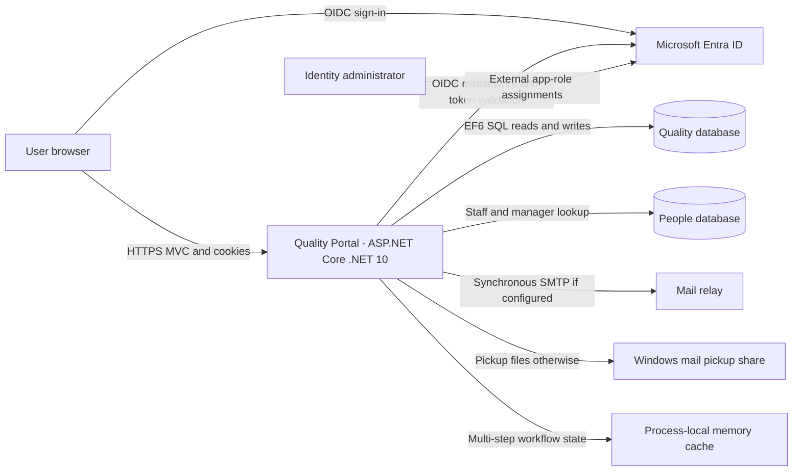

# Assessment - RPA.QualityPortal

## Identification

**Repository Name**: rpa-quality-checks (solution: `RPA.QualityPortal`)  
**Type**: Server-rendered ASP.NET Core MVC web application  
**Language**: C# and Razor, with JavaScript/CSS browser assets  
**Frameworks**: .NET 10 (`net10.0`), ASP.NET Core MVC, Entity Framework 6.5.2, Microsoft.Identity.Web 4.16.1  
**Repository URL**: Not established in this assessment; local workspace folder `rpa-quality-checks`  
**Assessment Date**: 2026-11-03  
**Scope and Method**: Static assessment of current project files, startup/registration, controllers, views, services, configuration, deployment artifacts and test source. No AppCAT scan, dependency installation, build, test execution, coverage measurement, live sign-in or Azure resource validation was performed for this report. Historical documentation and existing build outputs are not evidence of current runtime success.

Evidence: [application project](../RPA.QualityPortal/RPA.QualityPortal/RPA.QualityPortal.csproj), [Program.cs](../RPA.QualityPortal/RPA.QualityPortal/Program.cs), [current deployment guide](../README.md).

## Summary

RPA.QualityPortal supports human quality checking and re-checking of bank account changes and outbound correspondence, including multi-step questionnaires, results, challenges, amendments, locks, notifications, CSV export and management information. Its active implementation is already **.NET 10 / ASP.NET Core**, not the .NET Framework/MVC 5 application described in older assessments.

`Program.cs` calls `AddQualityPortalApplication` in [ApplicationServices.cs](../RPA.QualityPortal/RPA.QualityPortal/Services/ApplicationServices.cs), centralizing authentication, claims, authorization and application-service registration. Microsoft Entra OpenID Connect authorization-code sign-in and protected cookies replace Windows/Negotiate and IDT Security authentication. Seven explicitly configured, distinct app-role values preserve the portal's permission contracts. The staff-number claim and People lookup remain part of the audit contract.

**IDT runtime services and the IDT Security database are removed from the current registration/project configuration.** `IRoleManager` now checks token claims; it does not administer IDT or Entra roles. Access administration is external: the Access view is informational and its old POST returns **410 Gone after authorization and antiforgery checks**. There is **no automatic migration of IDT users, roles or assignments**.

Migration work remains around SQL connectivity, Windows-oriented mail pickup, server-local session state and production deployment acceptance. This report does not certify tenant setup, deployment readiness or operational feature parity.

## Service Dependencies

### Cloud Services (GCP/AWS/Azure)
- **Microsoft Entra ID**: Runtime identity provider through Microsoft.Identity.Web/OIDC. A single-tenant app registration, confidential-client credential, app roles, staff-number token claim and public HTTPS callback must be configured externally.
- No AWS/GCP SDK, Azure Storage, Key Vault client or Application Insights registration was identified in the application project/startup. A deployment secret store is required operationally but no particular store integration is implemented here.

Evidence: [project dependencies](../RPA.QualityPortal/RPA.QualityPortal/RPA.QualityPortal.csproj), [central registration](../RPA.QualityPortal/RPA.QualityPortal/Services/ApplicationServices.cs).

### Databases
- **QualityContext**: EF6 SQL Server application database for checks, questions, answers, results, amendments, audits, locks and worker-service logs. Explicit mappings retain `BankAccount`, `BankAccountReCheck`, `OutboundCorrespondence` and `OutboundCorrespondenceReCheck` tables.
- **PeopleContext**: EF6 SQL Server lookup for people, locations and managers. The normalized staff number is matched against `People.StaffNumber`; `People.Name` or `Unknown` is returned by `UserHelper`.
- The provider remains **System.Data.SqlClient / EF6**, not EF Core. Base connection strings use Integrated Security; the People connection explicitly disables encryption. Environment overlays replace selected Quality settings, not the entire configuration.
- **No current IDTSecurityConnection dependency** is registered. Historical references to a third Security database must not be used to provision a runtime dependency.
- Historical reports describe BAQU as a shared-database producer. This assessment does not revalidate that other repository or deployed database topology; confirm actual writers and schema contracts before changing or relocating Quality data.

Evidence: [QualityContext](../RPA.QualityPortal/RPA.QualityPortal/DAL/QualityContext.cs), [PeopleContext](../RPA.QualityPortal/RPA.QualityPortal/DAL/PeopleContext.cs), [provider configuration](../RPA.QualityPortal/RPA.QualityPortal/DAL/QualityDbConfiguration.cs), [UserHelper](../RPA.QualityPortal/RPA.QualityPortal/Helpers/UserHelper.cs), [base settings](../RPA.QualityPortal/RPA.QualityPortal/appsettings.json).

### Messaging
- No message broker, queue consumer or background message-dispatch infrastructure was identified.
- Email is sent synchronously through `System.Net.Mail.SmtpClient`, either to a configured SMTP host or to a pickup directory. This is not an implemented Azure Service Bus/Storage Queue integration.

Evidence: [SendService](../RPA.QualityPortal/RPA.QualityPortal/Services/SendService.cs).

### Storage
- Static assets are served from `wwwroot`.
- `Files` content, including an accreditation workbook, is copied to output/publish by the project. Its presence does not make the excluded accreditation controller active.
- Default mail delivery depends on a Windows UNC pickup directory when `Mail:Host` is empty.
- Multi-step workflow objects live by reference in **process-local IMemoryCache**, keyed by a separate session cookie, with a 480-minute sliding cache expiry. No distributed session store is registered.

Evidence: [project content rules](../RPA.QualityPortal/RPA.QualityPortal/RPA.QualityPortal.csproj), [session store](../RPA.QualityPortal/RPA.QualityPortal/Infrastructure/SessionStore.cs), [mail settings](../RPA.QualityPortal/RPA.QualityPortal/appsettings.json).

### APIs and External Integrations
- **Entra OIDC**: Browser authorization redirect and server-side protocol interaction handled by the identity middleware.
- **Email delivery**: `EmailService` builds notifications; `SendService` delivers over SMTP or writes pickup files. Recipient/business data comes from portal/People data.
- No application-owned REST client or Microsoft Graph role-management integration was identified in active registration/services. SQL, identity and mail are the demonstrated external integration boundaries.

Evidence: [authentication registration](../RPA.QualityPortal/RPA.QualityPortal/Services/ApplicationServices.cs), [EmailService](../RPA.QualityPortal/RPA.QualityPortal/Services/EmailService.cs), [SendService](../RPA.QualityPortal/RPA.QualityPortal/Services/SendService.cs).

### Other Dependencies
- EPPlus **4.5.3.3**, Newtonsoft.Json **13.0.4**, X.PagedList.Mvc.Core **10.6.0**, and System.Security.Cryptography.Pkcs **10.0.13** are explicitly referenced.
- Older browser assets remain in the Razor layout, including jQuery 3.4.1, jQuery UI 1.12.1, Modernizr 2.8.3 and Bootstrap. This report is not a current vulnerability scan.
- `IRoleManager` is a portal compatibility abstraction backed by `QualityPermissions`, not the former IDT role-management service.

Evidence: [application project](../RPA.QualityPortal/RPA.QualityPortal/RPA.QualityPortal.csproj), [layout](../RPA.QualityPortal/RPA.QualityPortal/Views/Shared/_Layout.cshtml), [RoleManager](../RPA.QualityPortal/RPA.QualityPortal/Services/RoleManager.cs).

## Communication

### Exposed Endpoints

The conventional MVC route is `{controller=Home}/{action=Index}/{id?}`. The table gives representative, source-backed active actions, not an exhaustive action inventory. **GET\*** means a browsing/form action without an explicit HTTP-verb restriction; it must not be interpreted as GET-only. Explicit POST and antiforgery restrictions are action-specific.

| Method | Path | Description | Authentication |
|--------|------|-------------|----------------|
| GET* | `/`, `/Home/Index` | Landing page and permission-filtered cards | Basic Access |
| GET* | `/BankAccount/Index`, `/BankAccount/Details?CheckId=...` | Bank check list and details | BA Team Member |
| GET* / POST | `/BankAccount/CreateGeneral` | Multi-step bank check form and submission | BA Team Member; POST has antiforgery validation |
| GET* | `/BankAccountReCheck/CreateBankReCheckQuestions?CheckId=...` | Begin bank re-check questionnaire | BA Team Member |
| GET* | `/OutboundCorrespondence/Index`, `/OutboundCorrespondence/Details?CheckId=...` | Correspondence list and details | OC Team Member OR OC Team Manager |
| GET* / POST | `/OutboundCorrespondence/CreateGeneral` | Correspondence form and submission | OC Team Member OR OC Team Manager; POST has antiforgery validation |
| GET* | `/OutboundCorrespondence/Export`, `/OutboundCorrespondence/ExportArchive` | CSV downloads | OC Team Member OR OC Team Manager |
| GET* | `/OutboundCorrespondenceMI/MIIndex`, `/OutboundCorrespondenceMI/MIDetails` | Management information and person detail | OC Team Member OR OC Team Manager |
| GET* | `/Admin/Index`, `/Admin/Access` | Administration landing page and external-access instructions | OC Admin OR BA Admin |
| POST | `/Admin/Access` | Retired access mutation; returns 410, no permission changes | OC Admin OR BA Admin plus antiforgery validation; earlier failures can prevent 410 |
| POST | `/Admin/DeleteLock` | Remove a check lock | OC Admin OR BA Admin; no action-level antiforgery attribute |
| GET* | `/People/PeopleSearch?searchstring=...` | People lookup | Authenticated-user fallback policy |
| GET | `/Account/AccessDenied` | Generic forbidden response, HTTP 403 | Anonymous allowed |
| GET | `/Account/AuthenticationFailed` | Generic sign-in failure response, HTTP 401 | Anonymous allowed |
| GET* | `/Error` | Production exception-handler view | Authenticated-user fallback policy |
| OIDC protocol callback | `/signin-oidc` (configurable) | Authentication middleware callback, not an MVC business action | OIDC protocol/token validation |

The active singular `OutboundCorrespondenceReCheckController` also implements re-check workflows under the outbound access policy. In contrast, `Controllers/OutboundCorrespondenceReChecksController.cs` and `Controllers/OutboundCorrespondence/OutboundCorrespondenceAccreditationController.cs` are **explicitly excluded from compilation**, as is the accreditation migration. They are not active endpoint evidence; re-enabling them needs separate permission and behavior review.

Policy values come from seven mandatory, distinct configured Entra role values: Basic Access, BA Team Member, BA Admin, BA Team Leader, OC Team Member, OC Team Manager and OC Admin. Matching uses the raw `roles` claim and ordinal, case-sensitive equality. **Admin/manager roles do not imply membership or Basic Access.** View links can be visible under a different OR expression than the controller's access policy; navigation visibility is not an authorization grant. Other unannotated MVC surfaces require authentication through the fallback policy; static files are served before authorization.

Evidence: [Program routing](../RPA.QualityPortal/RPA.QualityPortal/Program.cs), [BankAccount controller](../RPA.QualityPortal/RPA.QualityPortal/Controllers/BankAccount/BankAccountController.cs), [BankAccountReCheck controller](../RPA.QualityPortal/RPA.QualityPortal/Controllers/BankAccount/BankAccountReCheckController.cs), [OutboundCorrespondence controller](../RPA.QualityPortal/RPA.QualityPortal/Controllers/OutboundCorrespondence/OutboundCorrespondenceController.cs), [active outbound re-check controller](../RPA.QualityPortal/RPA.QualityPortal/Controllers/OutboundCorrespondence/OutboundCorrespondenceReCheckController.cs), [MI controller](../RPA.QualityPortal/RPA.QualityPortal/Controllers/OutboundCorrespondence/OutboundCorrespondenceMIController.cs), [Admin controller](../RPA.QualityPortal/RPA.QualityPortal/Controllers/AdminController.cs), [People controller](../RPA.QualityPortal/RPA.QualityPortal/Controllers/PeopleController.cs), [Account controller](../RPA.QualityPortal/RPA.QualityPortal/Controllers/AccountController.cs), [Error controller](../RPA.QualityPortal/RPA.QualityPortal/Controllers/ErrorController.cs), [permission contracts](../RPA.QualityPortal/RPA.QualityPortal/Services/QualityPermissions.cs), [compile exclusions](../RPA.QualityPortal/RPA.QualityPortal/RPA.QualityPortal.csproj).

### Consumed Endpoints
- The configured Entra authority supplies OIDC discovery/authorization/token endpoints through middleware; no tenant-specific endpoint values are reproduced here.
- SMTP delivery uses `Mail:Host` and `Mail:Port`, or the pickup-directory alternative.
- Quality and People are database connections, not HTTP APIs. No BAQU ingestion API or in-app Graph administration endpoint is implemented in the inspected source.

### Asynchronous Communication
- No broker-driven event flow or hosted background worker was identified in startup.
- `SmtpClient.Send` runs inline; pickup files defer actual transport to infrastructure outside this application.
- Worker-log entities and historical shared-database producer descriptions do not establish an active in-process worker or a guaranteed asynchronous queue contract.

### Communication Diagram

The diagram deliberately omits the removed IDT Security database and unverified external database writers.

## Configuration

### Environment Variables
- ASP.NET Core configuration is used, not legacy `Web.config` application settings. Hierarchical keys can be supplied externally with `__` replacing `:`; checked-in identity and role values are intentionally empty and cause startup to fail until supplied.
- Required deployment keys include `AzureAd__Instance`, `AzureAd__TenantId`, `AzureAd__ClientId`, `AzureAd__ClientSecret`, `Identity__AuditNameClaimType`, both `ConnectionStrings__QualityContext` and `ConnectionStrings__PeopleContext`, and all seven `Authorization__...Role` keys.
- `AzureAd__CallbackPath`, `Mail__Host`, `Mail__Port`, `Mail__PickupDirectory` and `ApplyMigrationsOnStartup` control callback, delivery and migration behavior. Standard environment selection governs `appsettings.{Environment}.json`.
- SQL/mail configuration is still present in base JSON and selected environment overlays; external configuration support does not mean all environment-specific values have been removed from source.

Evidence: [deployment key table](../README.md), [startup validation](../RPA.QualityPortal/RPA.QualityPortal/Services/ApplicationServices.cs), [base settings](../RPA.QualityPortal/RPA.QualityPortal/appsettings.json).

### Configuration Files
- [appsettings.json](../RPA.QualityPortal/RPA.QualityPortal/appsettings.json): logging, hosts, migration flag, identity/role placeholders, database and mail defaults.
- [appsettings.SIT.json](../RPA.QualityPortal/RPA.QualityPortal/appsettings.SIT.json) and [appsettings.Production.json](../RPA.QualityPortal/RPA.QualityPortal/appsettings.Production.json): Quality connection overrides.
- [appsettings.UAT.json](../RPA.QualityPortal/RPA.QualityPortal/appsettings.UAT.json): Quality and mail overrides.
- [launchSettings.json](../RPA.QualityPortal/RPA.QualityPortal/Properties/launchSettings.json): local launch profiles, not production provisioning.
- [application project](../RPA.QualityPortal/RPA.QualityPortal/RPA.QualityPortal.csproj): SDK-style package references and compile/content rules; [migration configuration](../RPA.QualityPortal/RPA.QualityPortal/Migrations/Configuration.cs) retains explicit EF6 migrations.
- [Views/Web.config](../RPA.QualityPortal/RPA.QualityPortal/Views/Web.config): retained MVC 5/Razor/System.Web artifact, not the ASP.NET Core authentication/configuration source.

### Secrets and Sensitive Parameters
- Do not commit the confidential-client credential. Inject it from the approved deployment secret store; no Key Vault retrieval client is wired into the application.
- Tenant/client identifiers, app-role assignments, approved staff claim, SQL access and mail routing are deployment-sensitive. This report intentionally omits internal hostnames, share paths, addresses and credential values.
- Base SQL settings use Windows Integrated Security. The People connection's `encrypt=False` requires an approved encrypted-transport configuration and certificate/connectivity validation for the target.
- The identity contract requires one matching `tid` and exactly one nonempty configured audit claim. Portal-specific normalization lowercases the staff value, strips two recognized legacy domain prefixes and replaces `m0` with `m`. UPN/email/display-name substitutions are not supported. The normalized staff value still drives the People display-name lookup; no Entra object-ID replacement is introduced.
- The authentication cookie is `__Host-QualityPortal.Auth`, HttpOnly, Secure, SameSite=Lax, path `/`, with 30-minute sliding expiry. Missing/invalid startup settings fail closed; role checks never infer default mappings. Assignment changes need a new ticket; session revocation remains an operational concern.

Evidence: [AuditIdentity](../RPA.QualityPortal/RPA.QualityPortal/Services/AuditIdentity.cs), [UserHelper](../RPA.QualityPortal/RPA.QualityPortal/Helpers/UserHelper.cs), [authentication/cookie options](../RPA.QualityPortal/RPA.QualityPortal/Services/ApplicationServices.cs), [deployment guide](../README.md).

## Infrastructure

### Containerization
- **Dockerfile / Compose**: None found in the assessed application folder.
- **Base Image / Exposed Ports**: No container definition to assess.
- .NET 10 removes the former framework-only hosting constraint, but does not prove Linux/container compatibility: Integrated Security, UNC pickup delivery and local state still need target-specific design and validation.

### Kubernetes/Helm
- **Manifests / Helm Charts**: None found in the assessed application folder. No cluster deployment was inspected or performed.

### Infrastructure as Code
- **Terraform / Bicep / ARM / CloudFormation**: No provisioning templates found in the assessed application folder.
- Entra registration/roles, hosting, secret injection, SQL networking and key storage are not provisioned by this source.

### CI/CD
- No application-specific build/deploy pipeline definition was found under `rpa-quality-checks`; this does not establish whether external pipelines exist.
- `ApplyMigrationsOnStartup` defaults to false. `Program.cs` can invoke EF6 `DbMigrator` when explicitly enabled. Its comment describes pipeline-managed schema changes, but is not evidence that a pipeline currently applies them.
- Deployment needs repeatable .NET 10 build/test/publish, configuration injection, controlled schema deployment and operational checks before release.

Evidence: [Program.cs](../RPA.QualityPortal/RPA.QualityPortal/Program.cs), [migration configuration](../RPA.QualityPortal/RPA.QualityPortal/Migrations/Configuration.cs), [base settings](../RPA.QualityPortal/RPA.QualityPortal/appsettings.json).

### Legacy Deployment Artifacts
- The project retains `AspNetCoreHostingModel=InProcess`, compatible with ASP.NET Core IIS hosting; this is not evidence of classic MVC 5 runtime hosting.
- `Views/Web.config` still references MVC 5/System.Web; it is a legacy artifact, not proof that membership/IDT services remain active.
- The current deployment guide requires IIS anonymous access and disabled Windows Authentication for this app. Trusted HTTPS termination/forwarded-header handling and persistent shared Data Protection keys must be configured where applicable; no explicit forwarded-header or shared-key setup is registered in `Program.cs`.

Evidence: [project](../RPA.QualityPortal/RPA.QualityPortal/RPA.QualityPortal.csproj), [retained view configuration](../RPA.QualityPortal/RPA.QualityPortal/Views/Web.config), [deployment guide](../README.md).

## Testing

### Coverage
- **Percentage**: Not measured for this assessment. Test files, historical reports and existing binaries do not establish current coverage or passing status.
- **Tooling**: The `net10.0` test project references NUnit 3.14.0, NUnit3TestAdapter 6.3.1, Moq 4.20.72, Microsoft.NET.Test.Sdk 18.11.0 and Microsoft.AspNetCore.Mvc.Testing 10.0.13.

Evidence: [test project](../RPA.QualityPortal/RPA.QualityPortal.Tests/RPA.QualityPortal.Tests.csproj).

### Test Types
- **Unit**: Controller, service and validation tests exist, with mocked Quality/People contexts.
- **In-process HTTP integration**: Authentication tests use `WebApplicationFactory<Program>`, real protected authentication tickets, mocked database contexts and offline OIDC metadata. They test challenges, cookie rejection, access-denied/failure responses, role-dependent views and retired access-form behavior.
- **Permission/identity contracts**: Tests cover required configuration, token/audit validation, staff normalization, display-name lookup/fallback, case-sensitive permissions and combinations of the seven roles.
- **Live integration / E2E**: The inspected authentication fixtures do not contact a real tenant or production databases. No live Entra/SQL/mail or browser deployment-acceptance evidence was established.

Evidence: [authentication HTTP tests](../RPA.QualityPortal/RPA.QualityPortal.Tests/Authentication/AuthenticationHttpTests.cs), [authentication unit tests](../RPA.QualityPortal/RPA.QualityPortal.Tests/Authentication/AuthenticationTests.cs), [permission tests](../RPA.QualityPortal/RPA.QualityPortal.Tests/Authentication/PermissionTests.cs), [controller tests](../RPA.QualityPortal/RPA.QualityPortal.Tests/Controllers), [service tests](../RPA.QualityPortal/RPA.QualityPortal.Tests/Services).

### Observations
- No tests were run to author this documentation. The README contains focused build/test instructions, not a result for this assessment.
- The HTTP fixture verifies rejection of an Admin Access POST without an antiforgery token; the controller's source returns 410 only after the existing access/antiforgery requirements are met. Do not equate every POST response with 410.
- Real tenant sign-in, emitted staff claim, app-role assignments, People resolution, audit persistence, SMTP/pickup delivery, SQL migrations and multi-instance operation remain deployment acceptance checks.

## Points of Attention for Multi-Cloud/Azure Migration

### Cloud-Specific Dependencies
- **Entra is now a real runtime dependency**, independent of the hosting cloud. Moving hosting to another provider would not remove the identity contract.
- Quality and People remain SQL Server dependencies using EF6/System.Data.SqlClient. Azure SQL or another SQL Server target needs explicit authentication, encryption, connectivity and migration validation; EF Core conversion is not a prerequisite merely to recognize the existing .NET 10 modernization.
- No active IDT database migration is required by the runnable authentication implementation. Identity administrators must separately approve/provision Entra role values and assignments; there is no automated IDT conversion.

### Hardcoded Configurations
- Base/environment JSON still contains environment-specific database locations and a Windows mail pickup path; exact values are intentionally not repeated.
- Integrated Security and disabled People SQL encryption are target-portability/hardening concerns.
- `SessionStore` fixes workflow expiry at 480 minutes; workflow state is local to one process and differs from the authentication cookie's lifetime. Instance restarts or cross-instance requests can lose that state.

Evidence: [settings](../RPA.QualityPortal/RPA.QualityPortal/appsettings.json), [session implementation](../RPA.QualityPortal/RPA.QualityPortal/Infrastructure/SessionStore.cs).

### Legacy Code or Old Patterns
- Retained EF6 migrations, synchronous database/mail operations, older UI libraries, EPPlus and the MVC 5 view configuration warrant maintenance review; they do not justify describing the active app as .NET Framework.
- Multi-step controllers retain session-shaped object graphs through an ASP.NET Core compatibility store rather than a distributed state design.
- Action HTTP-method/antiforgery behavior remains mixed. For example, `Admin/DeleteLock` is POST without an action-level antiforgery attribute. Review these contracts explicitly rather than claiming universal antiforgery enforcement.
- Accreditation/WIP sources are excluded, not migrated and activated. Their files and workbook must not be counted as supported production flows.

### Specific Recommendations
1. **Complete identity acceptance before cutover**: approve all seven distinct role values, create/assign Entra app roles, certify the single-tenant and staff-number claims, and test the independent permissions. Preserve the People staff-number/display-name audit contract and existing OR/AND view/service semantics.
2. **Retire IDT operationally without inventing migration automation**: document externally approved user/group assignments, ensure the Access page stays informational, and verify 410 behavior with valid admin/antiforgery context. No Graph permission or legacy Security database should be introduced merely to reproduce the old access form.
3. **Validate the target host**: configure .NET 10 hosting, public HTTPS callback and trusted proxy behavior; disable IIS Windows Authentication if IIS is used. Provision persistent shared Data Protection keys and plan ticket expiry/revocation.
4. **Design multi-instance state deliberately**: use an explicitly validated affinity/single-instance strategy initially or redesign the object-reference workflow store for distributed persistence. Sharing Data Protection keys alone does not share session objects.
5. **Harden and prove SQL connectivity**: externalize both connections, choose approved target authentication, enable validated TLS, and test Quality/People queries and audit writes. Review EF6 schema deployment/rollback and confirm other database writers before any breaking schema change.
6. **Replace or validate pickup delivery**: choose a supported mail relay or delivery service and validate network access, TLS/authentication requirements and notifications. The current network branch only sets SMTP host/port; it does not explicitly configure credentials or TLS.
7. **Establish reproducible release evidence**: run the existing focused tests, then appropriate regression/live acceptance tests; record real results and coverage separately. Validate CSV exports, re-check/challenge workflows, locks and notifications. Keep excluded accreditation work outside production scope until separately reviewed.
8. **Review retained dependencies/artifacts separately**: perform a current dependency/browser-library scan and assess cleanup without carrying historical AppCAT issue counts forward as current findings.

## Additional Observations
- [README.md](../README.md) is a current authentication/deployment contract, not an untouched scaffold. It explicitly documents external assignments, no automatic IDT migration, excluded controllers and remaining acceptance checks.
- [The October assessment](../docs/Report_20261006112031.md) labels itself historical and records earlier AppCAT runs. Its legacy architecture, counts and recommendations are not a fresh scan of the current application and are not adopted here.
- The [Access view](../RPA.QualityPortal/RPA.QualityPortal/Views/Admin/Access.cshtml) contains external-administration instructions, no role-mutation form. The current role adapter has only claim-based permission checks.
- This report preserves the bank-holidays assessment's heading structure while assessing current Quality Portal source. It changes no application code, infrastructure or historical report, and makes no live deployment-readiness claim.
